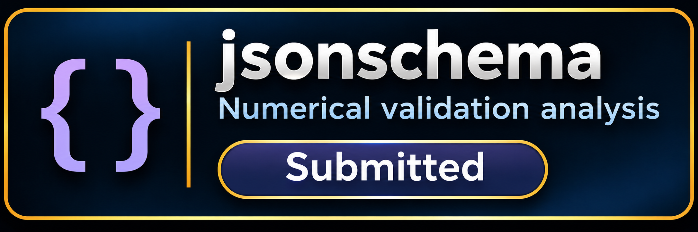

<h2>Danny Joe Hebel</h2>

Founder · Mathematical Researcher · Software Developer

---

## About

Independent mathematical researcher and founder of Mercy Systems, a research and software development company focused on computational mathematics, numerical verification, symbolic computation and scientific software.

Our research explores mathematical approaches to computational efficiency, numerical reliability and practical engineering challenges.

---

## Featured Mathematical Research

A mathematical framework designed to perform exact arithmetic across extreme differences in numerical scale without densely expanding intermediate representations.

The research explores sparse numerical representation, exact-scale arithmetic, cancellation analysis and computational efficiency.

**Publicly Available Research**

- Mathematical research manuscript
- Python reference implementation
- C reference implementation

**[View Research & Reference Implementations](https://doi.org/10.5281/zenodo.24485981)**

DOI: 10.5281/zenodo.24485981

---

## Open-Source Research Investigations

Applications of our mathematical research to numerical and computational challenges in established open-source software projects.

<table>
<tr>
<td width="50%" align="center">

 
<a href="https://github.com/golang/go/issues/42436#issuecomment-7144576157">Original Research Contribution</a>
 
<a href="https://github.com/golang/go/issues/42436#issuecomment-7154387698">Independent Contributor Testing</a>
 
<a href="https://github.com/golang/go/issues/42436">Full Project Discussion</a>
</td>
<td width="50%" align="center">

 
<a href="https://github.com/jqlang/jq/pull/3612#issuecomment-7118201424">Original Research Contribution</a>
 
<a href="https://github.com/jqlang/jq/pull/3612#issuecomment-7118934214">Independent Reproduction</a>
 
<a href="https://github.com/jqlang/jq/pull/3612">Full Project Discussion</a>
</td>
</tr>
<tr>
<td width="50%" align="center">

 
<a href="https://github.com/santhosh-tekuri/jsonschema/issues/293#issuecomment-7143229348">Original Research Contribution</a>
 
<a href="https://github.com/santhosh-tekuri/jsonschema/issues/293">Full Project Discussion</a>
</td>
<td width="50%" align="center">

 
<a href="https://github.com/leanprover/lean4/issues/16538#issuecomment-7147513785">Original Research Contribution</a>
 
<a href="https://github.com/leanprover/lean4/issues/16538">Full Project Discussion</a>
</td>
</tr>
</table>

These investigations represent submitted research, proposed solutions and specific reproducible findings. They do not imply formal project endorsement or adoption of HSES.

---

## Research Capabilities

| Mathematical Research | Computational Research |
| :--- | :--- |
| Exact Arithmetic | Numerical Verification |
| Symbolic Computation | Scientific Computing |
| Computer Algebra | Software Diagnostics |
| Sparse Numerical Representation | Computational Efficiency |
| Extreme-Scale Arithmetic | Numerical Error Detection |

---

## Research & Commercial Collaboration

Mercy Systems welcomes inquiries from researchers, engineering teams, scientific institutions and technology companies.

Available for:

- Sponsored mathematical research
- Paid technical evaluations
- Numerical accuracy and reliability investigations
- Scientific software research and development
- Collaborative research projects
- Commercial applications of mathematical research

<h3>Contact</h3>

<strong>Danny Joe Hebel</strong>

Founder — Mercy Systems

<a href="mailto:danny@mercysystems.com">Danny@MercySystems.com</a>

<a href="https://mercysystems.com">MercySystems.com</a>

<strong>MERCY SYSTEMS</strong>

Research & Development

